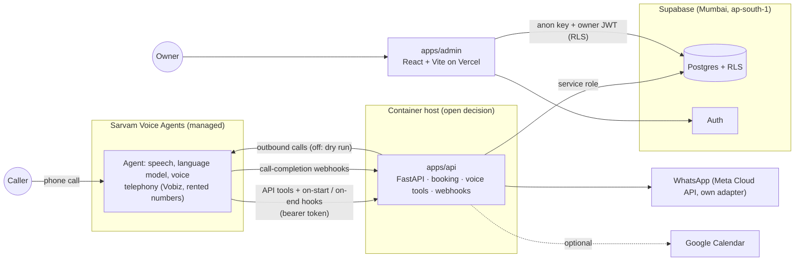

# SalesBot

An inbound AI voice receptionist for small businesses. It answers calls in **Hindi, Marathi or
English**, books appointments, captures every lead, and shows the owner what happened.

It works for any business that takes calls (clinics, salons, real estate, repair shops). A dental
clinic is the first example. There is **one generic engine** plus **industry packs** (YAML config):
intake questions, services and durations, FAQs, emergency triggers, lead stages, greeting.

The admin app is the real product: calls, leads, bookings and the revenue funnel
(calls → leads → bookings → shows → paid).

## Architecture



We run no voice pipeline. Sarvam runs the call; every business rule (patients, availability,
booking, reminders, staff tasks, audit log, costs) lives in `apps/api` and Postgres, so the voice
vendor can be swapped. The agent's instruction and spoken lines are rendered from the pack
(`make voice-agent`). Setup: [docs/SARVAM_AGENT.md](docs/SARVAM_AGENT.md). Prices and the spend
guard: [docs/COSTS.md](docs/COSTS.md).

## Quickstart

Prerequisites: [uv](https://docs.astral.sh/uv/), Node 22+, GNU Make (on Windows use Git Bash:
`winget install ezwinports.make`). For the local database only: Docker and the
[Supabase CLI](https://supabase.com/docs/guides/local-development/cli/getting-started).

```bash
cp .env.example .env               # fill in later; everything runs on mocks with it empty
cp apps/admin/.env.example apps/admin/.env
make setup                         # uv sync + npm install + git hooks
make test                          # unit tests + admin build (DB tests skip without a DB)
make dev-api                       # http://localhost:8000/health
make console ARGS='--lang hi'      # chat with the appointment flow in the terminal (no DB)
make voice-agent                   # print the Sarvam agent setup rendered from the clinic pack
make dev-admin                     # http://localhost:5173 (needs Supabase URL + anon key)
```

The local database is deferred for now (see [docs/DECISIONS.md](docs/DECISIONS.md)). When you need it:

```bash
make db-up                         # requires Docker + Supabase CLI; prints URL and keys
make db-reset                      # applies supabase/migrations + seed.sql
# demo login: owner@demo.local / demo-password-local-only
```

## Make targets

| Target | What it does |
|---|---|
| `setup` | Install Python (uv workspace) and admin (npm) deps, install pre-commit hooks |
| `dev-api` | FastAPI with reload on :8000 |
| `console` | Chat with the appointment flow in the terminal, no DB (`ARGS='--lang mr'`) |
| `demo` | Local demo page on http://127.0.0.1:8000/demo (fake clinic, `DEMO_MODE` for that process only; docs/DEMO.md) |
| `demo-seed` / `demo-reset` | Seed / delete and re-seed the fake demo clinic only; refuse production-like databases |
| `voice-agent` | Render the Sarvam agent's instruction, greetings, KB text and tool cURLs from a pack (`PACK=clinic`) |
| `voice-ops` | Spend caps, test-run guard, outbound dry run, cost actuals (`ARGS='spend'`, see docs/COSTS.md) |
| `dev-admin` | Admin app on :5173 |
| `db-up` / `db-down` | Start / stop local Supabase. **Requires Docker and the Supabase CLI** |
| `db-reset` | Rebuild local DB from migrations + seed. **Requires Docker and the Supabase CLI** |
| `migrate` | `supabase db push` to the **linked** remote project (linking needs approval) |
| `test` | pytest (RLS test skips without a DB) + admin build |
| `lint` | ruff check + format check, eslint + tsc |
| `format` | ruff fix + format |

## Deploying the admin app (Vercel)

Vercel deploys **only `apps/admin`**. In the Vercel project settings set **Root Directory =
`apps/admin`**. Set `VITE_SUPABASE_URL` and `VITE_SUPABASE_ANON_KEY` only. The build refuses to
run if a service role key shows up in any `VITE_` variable.

`apps/api` ships as a Docker image (build from the repo root:
`docker build -f apps/api/Dockerfile .`) for a long-running container host (not chosen yet).

## Folder map

```
apps/
  api/            FastAPI: booking, intake, voice tools/hooks/webhooks (voice/), outbound calls, spend guard
  admin/          React + Vite + Supabase JS: login, Calls, Leads, Knowledge base, Metrics, Setup
packages/core/    Shared Python: packs, flow engine, text, scheduling, costs (rates.yaml), voice lines
packs/            Industry packs (clinic.yaml, dentist.yaml, salon.yaml)
supabase/         config.toml, migrations/ (the only schema source), seed.sql, tests/ (RLS isolation)
docs/             ARCHITECTURE, GTM, DECISIONS, PROVIDERS, COSTS, SARVAM_AGENT, INTAKE_CONTRACT,
                  DEMO (local demo), STATUS (stages and evidence)
```

## Status and roadmap

**Now (Anvia Phase 1, Stage B):** flow engine and text console; Sarvam Voice Agents integration
(API tools, hooks, webhooks, cost tracking, spend guard); outbound calls built but **off** (dry
run). Nothing calls Sarvam unless its settings are filled in, and nothing spends credits without
the owner's go.

Next: WhatsApp (Stage C) against a mock client, then the hosted dev database, then the first
voice test on the owner's team's phones.
